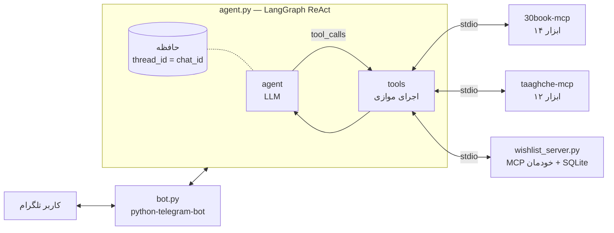

# BookBot — دستیار کتاب تلگرامی با LangGraph و MCP

این یه ربات تلگرامه که با کمک ایجنت کتاب پیشنهاد میده و قیمت نسخه‌ی چاپی رو از ۳۰بوک با نسخه‌ی الکترونیکی یا صوتی طاقچه مقایسه میکنه کاربرم می‌تونه کتابای مورد علاقه‌شو توی لیست علاقه‌مندی‌هاش ذخیره کنه

## معماری



- **چند سرور MCP**: یک کلاینت به هر سه سرور وصل میشه و ابزارها با پیشوند نام سرور به مدل داده میشن
- **MCP سرور اختصاصی**: سرور ویش‌لیست لیست علاقه‌مندی هر کاربر رو جداگونه نگه می‌داره
- **امنیت**: یوزرآیدی از تلگرام تزریق میشه و توی اسکیمای ابزار به مدل نشون داده نمیشه پس حتی با پرامپت اینجکشن هم کسی به لیست کاربر دیگه دسترسی نداره کلیدهای ای‌پی‌آی هم به سرورهای MCP شخص ثالث داده نمیشن
- **حافظه‌ی گفتگو**: چِک‌پوینتر لنگ‌گراف با تیرید آیدیِ چت آیدی کار میکنه و دستور نیو گفتگو رو پاک میکنه تاریخچه‌ی طولانی هم کوتاه میشه
- **تجربه‌ی کاربری**: منوی دکمه‌ای دکمه‌ی لینک و دکمه‌ی ذخیره زیر هر کتاب پیام وضعیت زنده با استریم گراف لیست علاقه‌مندی با دکمه‌ی حذف و اجرای موازی ابزارها

## اجرا

برای این کار به پایتون نسخه ده به بالا و ابزار یووی نیاز دارید چون سرورهای ۳۰بوک و طاقچه با یووی‌اکس اجرا میشن

```bash
uv venv && uv pip install -r requirements.txt
cp .env.example .env   # کلیدهای ای‌پی‌آی رو اینجا پر کنید
python agent.py        # تست در ترمینال بدون تلگرام
python bot.py          # اجرای ربات
python test_bot.py     # تست ایزوله بودن لیست علاقه‌مندی
```

اگه تلگرام فیلتره می‌تونید پروکسی رو تنظیم کنید و اگه ربات روی سرور خارج اجرا میشه و ۳۰بوک یا طاقچه جواب نمیدن متغیرهای پراکسی مربوطه رو ست کنید

## محدودیت‌ها

- سرورهای ۳۰بوک و طاقچه از ای‌پی‌آی غیررسمی استفاده میکنن و ممکنه گاهی از کار بیفتن
- حافظه‌ی گفتگو توی رم هست و با ری‌استارت پاک میشه اما لیست علاقه‌مندی توی دیتابیس  سیو می‌مونه

## قدردانی

سرورهای MCP ۳۰بوک و طاقچه رو از [MCP فارسی](https://mcpfarsi.ir) پیدا کردیم و استفاده کردیم؛ مرجع سرورهای MCP فارسی
